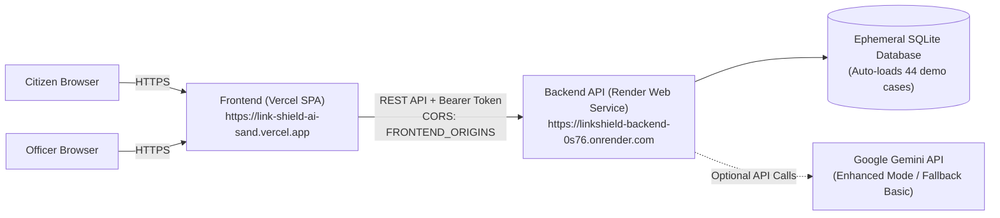

# LinkShield AI - Cloud Deployment Guide (Vercel & Render)

This guide documents how to deploy **LinkShield AI** in production with the **Frontend on Vercel** and the **Backend on Render** (free-tier web service).

---

## 🌐 Live Deployment Links

* **Live Frontend (Vercel):** https://link-shield-ai-sand.vercel.app
* **Live Backend Health Check (Render):** https://linkshield-backend-0s76.onrender.com/api/health
* **Live Backend API Root:** https://linkshield-backend-0s76.onrender.com/api

> **Note:** The backend runs on a free tier and may take about a minute to wake up on the first request; demo data reloads automatically after a restart.

---

## 🏛️ Deployment Architecture Overview



---

## Part 1: Deploying the Backend on Render

Render hosts the FastAPI application as a Python Web Service.

### Option A: Using Render Blueprints (`render.yaml` - Recommended)

The repository root includes a `render.yaml` specification.
1. Sign in to [Render](https://dashboard.render.com/).
2. Click **New +** -> **Blueprint**.
3. Connect your GitHub repository (`Link-Shield-AI`) and select the `deploy` (or `main`) branch.
4. Render automatically detects `render.yaml` with pre-configured settings:
   - **Runtime:** Python 3.11
   - **Root Directory:** `backend`
   - **Build Command:** `pip install -r requirements.txt`
   - **Start Command:** `uvicorn app.main:app --host 0.0.0.0 --port $PORT`
   - **Health Check Path:** `/api/health`
5. Fill in the prompted environment variables (see below) and click **Apply**.

### Option B: Manual Web Service Setup on Render

1. Sign in to [Render](https://dashboard.render.com/).
2. Click **New +** -> **Web Service**.
3. Connect your GitHub repository.
4. Configure the service settings:
   - **Name:** `linkshield-backend` (or your choice)
   - **Region:** Singapore / Frankfurt / Oregon (choose closest to your users)
   - **Branch:** `main` or `deploy`
   - **Root Directory:** `backend`
   - **Runtime:** `Python 3`
   - **Build Command:** `pip install -r requirements.txt`
   - **Start Command:** `uvicorn app.main:app --host 0.0.0.0 --port $PORT`
   - **Plan:** Free

### Render Environment Variables

Configure these under **Environment** in your Render dashboard:

| Variable | Recommended / Example Value | Description |
| :--- | :--- | :--- |
| `ENVIRONMENT` | `production` | Enforces production mode and security checks |
| `SECRET_KEY` | *(Generate a 32-byte hex key)* | **Required in production.** Must be strong random string (e.g. run `openssl rand -hex 32`) |
| `FRONTEND_ORIGINS` | `https://link-shield-ai-sand.vercel.app,http://localhost:5173` | Comma-separated list of allowed frontend origins for CORS |
| `AUTO_LOAD_DEMO_DATA` | `true` | Automatically loads the 44 demo cases if the database is fresh |
| `DEMO_MODE` | `true` | Enables demo dataset management features |
| `GEMINI_API_KEY` | `your-gemini-api-key-here` | *(Optional)* If empty, backend boots and operates safely in Basic rule-based mode |
| `GEMINI_MODEL` | `gemini-2.5-flash` | Gemini model name |
| `AI_ASSIST_ANALYSIS` | `true` | Enable AI second opinion for analyses |
| `ALLOW_EXTERNAL_AI_FOR_REAL_CASES` | `false` | Mask live identifiers before external transmission |

> [!IMPORTANT]
> **Production SECRET_KEY Enforcement:** LinkShield refuses to start in `production` mode if `SECRET_KEY` is empty, short (< 16 chars), or uses the default placeholder. Generate a strong key for your Render service.

---

## Part 2: Deploying the Frontend on Vercel

Vercel builds and hosts the React Vite Single-Page Application (SPA).

### Step-by-Step Vercel Setup

1. Sign in to [Vercel](https://vercel.com/).
2. Click **Add New...** -> **Project**.
3. Import your GitHub repository (`Link-Shield-AI`).
4. Configure the project settings:
   - **Project Name:** `link-shield-ai` (or your choice)
   - **Framework Preset:** `Vite`
   - **Root Directory:** Click **Edit** and select `frontend`
   - **Build Command:** `npm run build` (or `vite build`)
   - **Output Directory:** `dist`
   - **Install Command:** `npm install`
5. In **Environment Variables**, add:
   - **Name:** `VITE_API_BASE_URL`
   - **Value:** `https://linkshield-backend-0s76.onrender.com/api` *(your actual Render backend API URL, including `/api` without trailing slash)*
6. Click **Deploy**.

### SPA Routing on Vercel
The repository includes `frontend/vercel.json`:
```json
{
  "rewrites": [
    {
      "source": "/(.*)",
      "destination": "/"
    }
  ]
}
```
This ensures direct URLs (such as `/analyze/message`, `/cases`, `/radar`) reload correctly instead of returning 404.

---

## Part 3: Linking Frontend & Backend

Once both are deployed:
1. Copy your Vercel URL (`https://link-shield-ai-sand.vercel.app`).
2. Go to your Render service -> **Environment**.
3. Update `FRONTEND_ORIGINS` to include your Vercel URL:
   ```env
   FRONTEND_ORIGINS=https://link-shield-ai-sand.vercel.app,http://localhost:5173
   ```
4. Save changes in Render (triggers a quick redeploy).

---

## Part 4: Verification Checklist

Test the live deployment against this verification checklist:

1. **Health Check:**
   - Open `https://linkshield-backend-0s76.onrender.com/api/health` in your browser.
   - Verify it returns HTTP 200 with `{"status": "ok", "database": "connected"}`.
2. **Deep-Link Refresh (SPA Rewrites):**
   - In your browser, navigate directly to `https://link-shield-ai-sand.vercel.app/login` or `https://link-shield-ai-sand.vercel.app/analyze/message`.
   - Press **F5 / Hard Refresh**. The page should render cleanly without 404 errors.
3. **Citizen Mode & Analysis:**
   - Log in or test in Citizen mode.
   - Run a test SMS scan (e.g. electricity disconnection alert).
   - Verify risk score, indicators, and Hindi/English advice display immediately.
4. **Officer Authentication & Session:**
   - Log in with Officer demo credentials (`officer_sharma` / `Officer@Shield2026`).
   - Confirm authentication succeeds via Bearer token and that the Threat Intelligence dashboard loads.
5. **Cross-Origin Auth & Cookie Security:**
   - Open DevTools -> Application / Network.
   - Confirm headers include `Authorization: Bearer <token>` and cookies set with `SameSite=None; Secure`.
6. **PDF Dossier Generation:**
   - In Officer mode, open any case in Case Management (`/cases`).
   - Click **Download PDF Dossier**.
   - Verify the PDF downloads cleanly and that Hindi/Devanagari characters render crisply via bundled Noto Sans Devanagari.
7. **Assistant Interrogation:**
   - Open Officer Assistant.
   - Verify status shows "Gemini connected" (if API key provided) or "Basic mode: API key not configured" (if key omitted).

---

## ⚠️ Free-Tier Platform Limitations & Notes

| Limitation | Impact | Mitigation / Built-in Handling |
| :--- | :--- | :--- |
| **Render Cold Starts** | The free Render web service spins down after 15 minutes of inactivity. | The first request after sleep may take ~30-50 seconds to respond. A friendly loading state or pinging `/api/health` wakes up the instance. |
| **Ephemeral SQLite Storage** | Free Render instances have an ephemeral disk that resets upon redeployment or spin-down. | LinkShield includes `AUTO_LOAD_DEMO_DATA=true`, which automatically self-seeds the 44 synthetic demo cases whenever an empty database boots up. For persistent cloud storage, point `DATABASE_URL` to a persistent disk or hosted PostgreSQL database. |
| **Cross-Script Fonts** | Linux cloud servers do not include Windows Nirmala UI. | LinkShield bundles open TrueType fonts (`NotoSans-Regular.ttf`, `NotoSans-Bold.ttf`, `NotoSansDevanagari-Regular.ttf` & `NotoSansDevanagari-Bold.ttf`) in `backend/fonts/` so bilingual PDF reports render without glyph dropouts. |
| **Gemini Free-Tier Rate Limits** | External Gemini API calls may experience rate limits under high query volume. | LinkShield implements a 10-second timeout for analysis calls and a 20-second timeout for assistant chat, gracefully and transparently falling back to 100% offline rule-based Basic mode. |

---

## 👥 Demo Credentials (Demo only, synthetic data)

- **Officer Demo:** `officer_sharma` / `Officer@Shield2026` *(demo only, synthetic data)*
- **Admin Demo:** `admin_cyber` / `Admin@Shield2026` *(demo only, synthetic data)*
- **Citizen Demo:** `citizen_demo` / `Citizen@Shield2026` *(demo only, synthetic data — Citizens can also self-register directly)*
